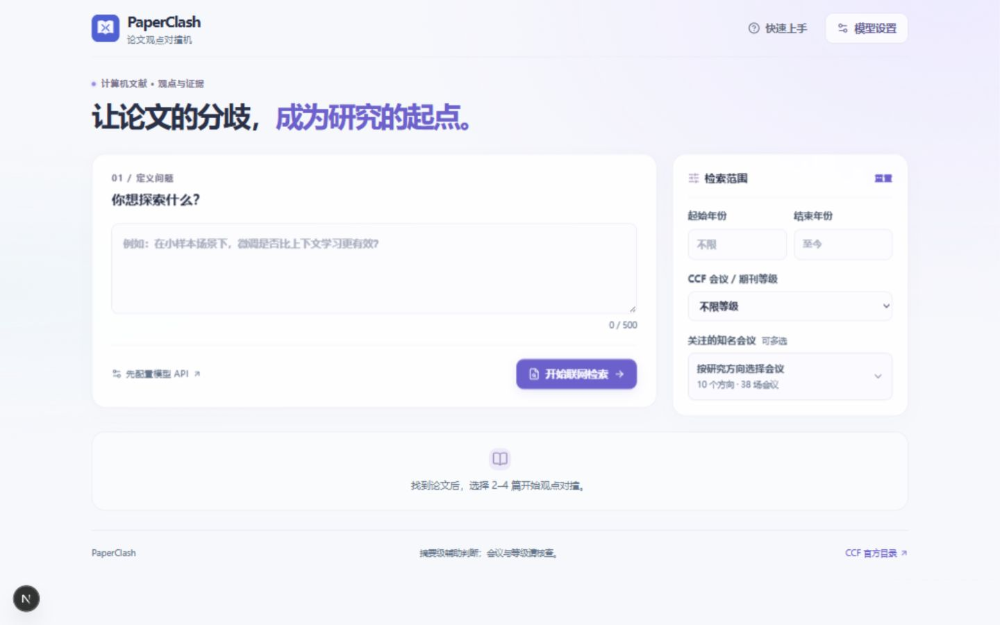

# PaperClash｜论文观点对撞机

**让论文的分歧，成为研究的起点。**

PaperClash 是面向计算机领域学生的轻量文献研究工具。围绕一个研究问题，检索全球论文，选择 2–4 篇摘要，对照观点、研究条件与原文证据，再整理值得进一步验证的选题思路。界面使用简体中文，无需注册或登录。



## 主要功能

- **联网检索**：按发表年份、CCF 等级和关注会议缩小范围；内置 10 个研究方向、38 场知名会议，可搜索与多选。
- **观点对撞**：展示支持、反对、条件性或证据不足，比较两篇论文是潜在冲突、条件不同、观点一致还是无法判定。
- **证据溯源**：展开摘要并高亮引文，打开论文来源；结果经过结构校验和摘要引文子串检查。
- **研究启发**：汇总创新点、局限及候选方向，提供难度、撞车风险与后续验证建议。
- **自定义模型**：填写自己的模型名称和 API Key；也可先体验不依赖网络或密钥的真实论文示例。

## 下载与启动

### 1. 下载源码

在本仓库页面点击 **Code → Download ZIP**，解压后进入包含 `package.json` 的文件夹。

也可以使用 Git：

```bash
git clone https://github.com/smallsmallrui214/PaperClash.git
cd PaperClash
```

这是需要本地运行的 Web 项目，没有独立的 Windows 安装程序。

### 2. 安装依赖并运行

准备 **Node.js 22 或更新版本**（推荐 LTS 版本，包含 npm），在项目根目录打开终端：

```bash
npm ci
npm run dev
```

浏览器打开 [http://localhost:3000](http://localhost:3000)。如果端口被占用，以终端提示的地址为准。停止服务时在终端按 `Ctrl+C`。

### 3. 先体验示例

点击右上角 **快速上手 → 体验真实论文示例**，直接完成选择、观点分析、证据查看和研究启发。示例使用 BERT 与 GPT-3 的真实摘要节选及预设分析，不调用外部模型。

## 配置模型与使用

点击右上角 **模型设置**，选择提供商，填写该账号可调用的模型 ID 和对应 API Key。配置在页面中完成，无需创建 `.env` 文件。

| 提供商 | 联网检索 | 观点分析与研究启发 |
| --- | --- | --- |
| OpenAI | 需要支持 Web Search 的模型及账号权限 | 已接入 |
| Claude / Anthropic | 需要支持联网搜索的模型及账号权限 | 已接入 |
| DeepSeek | 当前需使用 `deepseek-v4-pro` | 已接入 |
| GLM / 智谱 | 尚未接入联网检索 | 已接入 |
| Kimi / Moonshot | 尚未接入联网检索 | 已接入 |

模型需支持项目要求的 JSON 输出；实际可用性取决于模型、账号权限和服务商。可先用支持联网的模型检索，再切换提供商进行分析。

1. 输入具体研究问题，可以使用中文。
2. 选择起止年份、CCF 等级或知名会议；未选会议时不限会议来源。多选会议之间取“或”，与年份、等级条件取交集。
3. 点击 **开始联网检索**。模型通过联网搜索提出候选，系统使用 Crossref 核验题录、年份并获取摘要。
4. 勾选 **2–4 篇**论文，点击 **开始观点分析**；在结果中筛选立场、切换对照论文或展开证据。
5. 点击 **生成研究启发**，整理后续可探索的问题。

API Key 仅保存在当前页面内存中，刷新后清除；调用会经应用服务器转发至所选模型厂商，问题与摘要也会一并发送。请在自己信任的部署中使用，公开部署应启用 HTTPS。模型和联网搜索可能产生费用。

## 使用边界

- 检索只展示有可核验 DOI 和 Crossref 摘要的记录，可能遗漏缺少元数据的论文；没有结果时可减少筛选条件或调整问题。
- 会议归属与 CCF 等级由模型筛选，尚未独立程序核验，请查阅正式论文集及 CCF 官方目录。会议选集不构成完整排名。
- 分析基于摘要，每篇最多使用前 4000 个字符，不是全文评审。真实引文不代表模型解释一定正确，请回到原文核查。
- 选题、新颖性、难度与撞车风险只是初步参考，仍需最新文献检索和实验验证。

## 构建与检查

```bash
npm run lint
npm run test
npm run build
```

以生产模式运行：

```bash
npm run build
npm start
```

## 源码结构

```text
app/            页面、样式及检索 / 分析 / 研究启发 API
components/     弹窗与会议选择组件
lib/            数据校验、模型调用、联网搜索与会议目录
fixtures/       示例资料与测试数据
public/         页面使用的静态资源
__tests__/      自动化测试
docs/images/    README 界面截图
```

技术栈：Next.js App Router、React、TypeScript、Tailwind CSS、Lucide、Zod 与 Vitest。依赖版本由 `package-lock.json` 固定，建议使用 `npm ci` 安装。

